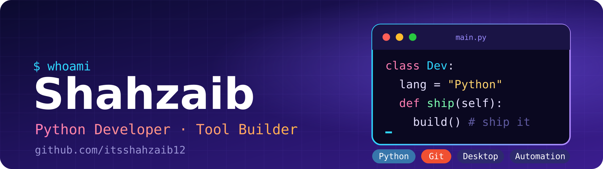
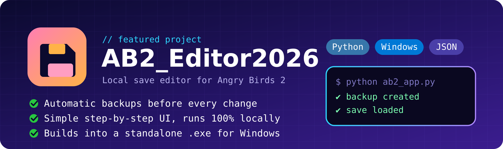

[README (1).md](https://github.com/user-attachments/files/34793659/README.1.md)
<div align="center">



<br/>

[](https://github.com/itsshahzaib12)


</div>

## 👨‍💻 About me

```python
class Developer:
    name = "Shahzaib"
    github = "itsshahzaib12"
    language = "Python"
    focus = ["Desktop tools", "Save editors", "Automation"]
    learning = ["Git workflows", "GUI design", "Packaging .exe apps"]
    building = "AB2_Editor2026"

    def say_hi(self):
        print("Thanks for stopping by! Open an issue if you want to chat.")

Developer().say_hi()
```

<div align="center"></div>

## 🚀 Featured project

<div align="center">
<a href="https://github.com/itsshahzaib12/AB2_Editor2026">
  
</a>
</div>

<div align="center"></div>

## 🧰 Tech stack

<div align="center">
  
</div>

<div align="center"></div>

## 🎯 Goals for 2026

- [x] Publish my first full desktop tool
- [ ] Release a downloadable `.exe` for AB2_Editor2026
- [ ] Learn proper Git branching and pull requests
- [ ] Contribute to an open-source project

<div align="center"></div>

<div align="center">

### 🤝 Let's connect

[](https://github.com/itsshahzaib12)

⭐ If one of my projects helped you, a star means a lot!

</div>
